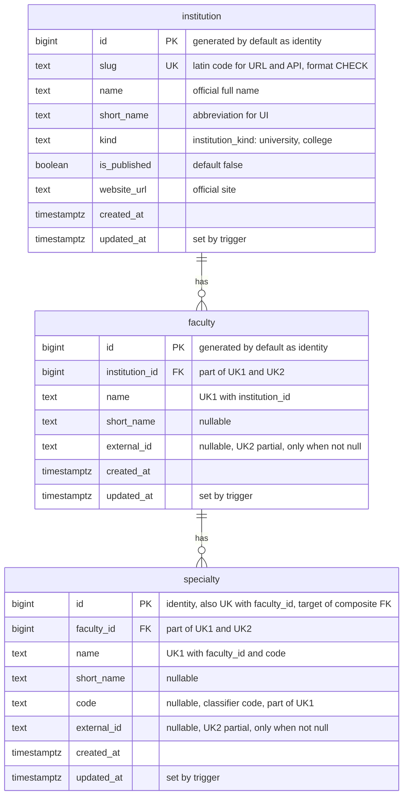

# Database ER diagram

Catalog of educational institutions: an institution has faculties, a faculty has specialties.

## Unique keys

| Table | Key | Columns | Notes |
|---|---|---|---|
| `institution` | UK | `slug` | format enforced by CHECK |
| `faculty` | UK1 | `institution_id`, `name` | |
| `faculty` | UK2 | `institution_id`, `external_id` | partial: `WHERE external_id IS NOT NULL` |
| `specialty` | UK | `faculty_id`, `id` | target of a composite FK from child tables |
| `specialty` | UK1 | `faculty_id`, `name`, `code` | |
| `specialty` | UK2 | `faculty_id`, `external_id` | partial: `WHERE external_id IS NOT NULL` |
